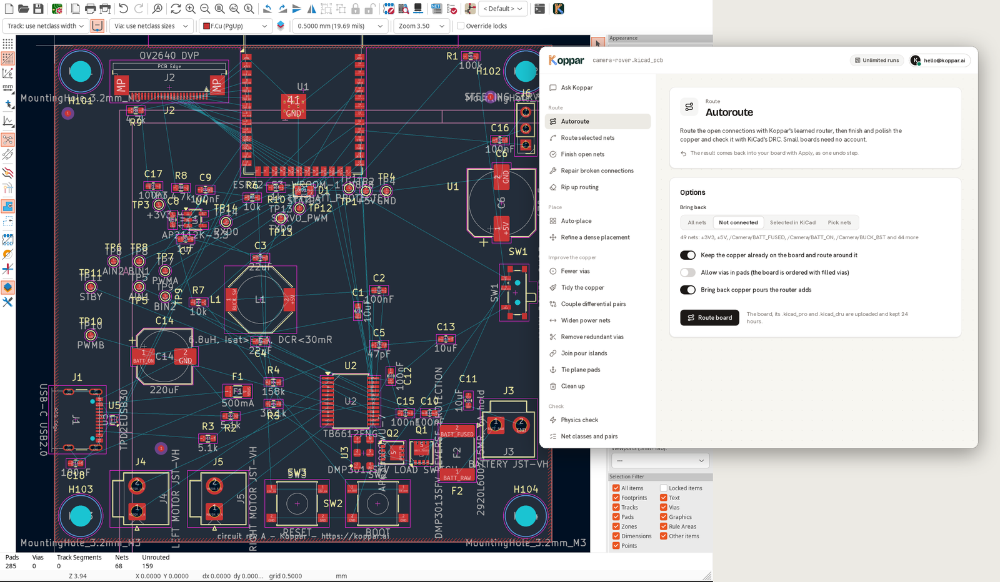
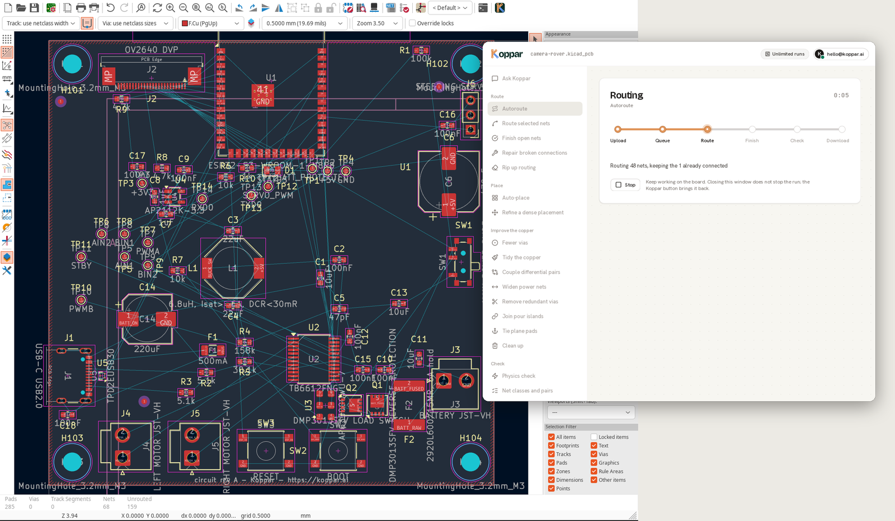
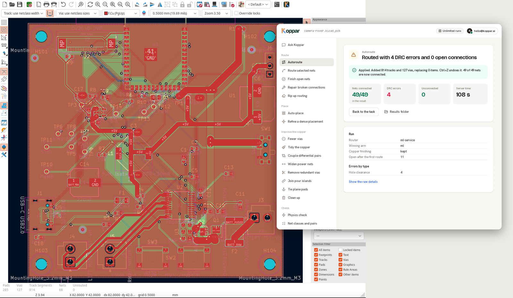
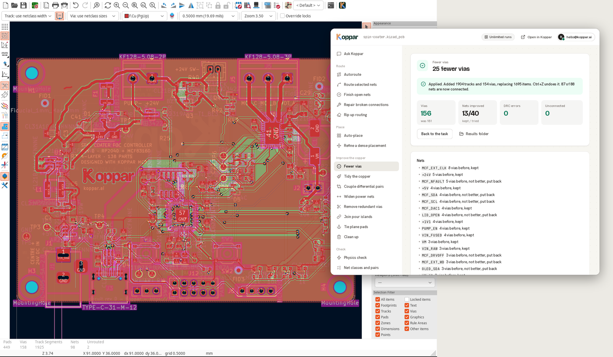
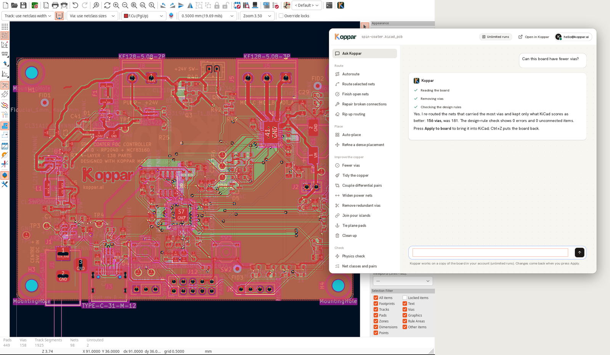
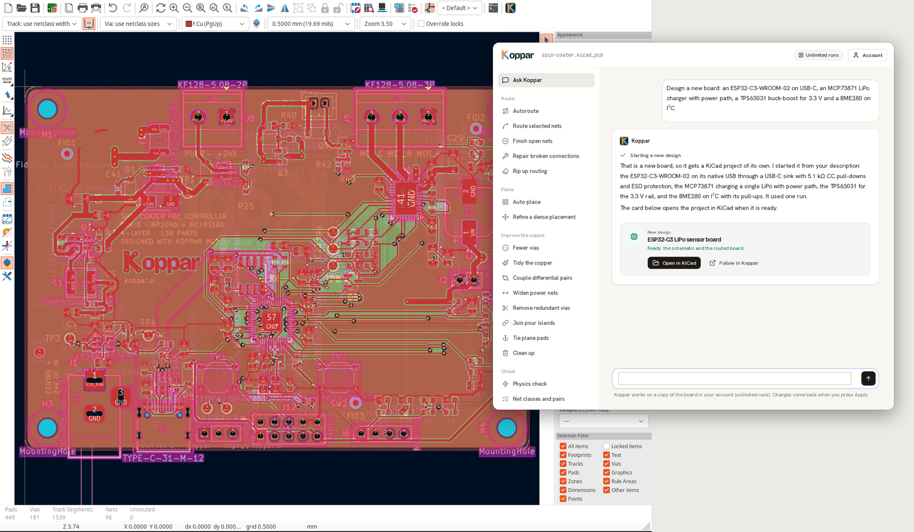

# Koppar for KiCad

Koppar's autorouter and board tools inside KiCad's PCB editor. One toolbar
button opens the Koppar window; whatever a task changes comes back into the
board as **one step on KiCad's undo stack**. Ask Koppar also designs new
boards from a description, schematic and layout, as KiCad projects.

- **Autoroute** routes the open connections with Koppar's learned router, then
  finishes and polishes the copper and checks it with KiCad's design-rule
  check. Small boards need no account.
- With a Koppar account (an API key from [app.koppar.ai/settings](https://app.koppar.ai/settings),
  or the key of the Koppar CLI's `koppar login`), the account's board tools:

| Group | Tasks | Comes back as |
|---|---|---|
| Route | Autoroute, route selected nets, finish open nets, repair broken connections, rip up | copper |
| Place | auto-place, refine a dense placement | placement and copper |
| Improve the copper | fewer vias, tidy, couple differential pairs, widen power nets, remove redundant vias, join pour islands, tie plane pads, clean up | copper |
| Check | physics (impedance, current, skew), net classes and pairs, why nets do not route | a report |

KiCad's own design-rule check, plots, 3D viewer and STEP export stay where
they are, in KiCad.

## Install

KiCad 7 to 10, on Linux, macOS or Windows. Nothing else to install: the plugin
uses only Python's standard library and the `pcbnew` and `wx` modules KiCad
ships with.

1. Download `koppar-kicad-<version>.zip` from the releases, or build it with
   `python3 build_package.py`.
2. In KiCad, open the **Plugin and Content Manager**, choose **Install from
   File...** and pick the zip.
3. Restart the PCB editor. The **Koppar** button is on the top toolbar, and
   under **Tools > External Plugins**.

To install by hand, copy `koppar/` into KiCad's scripting plugins folder
(`~/.local/share/kicad/<version>/scripting/plugins/` on Linux,
`~/Documents/KiCad/<version>/scripting/plugins/` on macOS and Windows).

## Use

Save the board (Koppar keeps its jobs beside the board file), then press **Koppar**.

- **Pick a task** on the left. Tasks marked with a key need an account
  (**Add API key** in the header).
- **Options**: the ones that matter, with plain labels. Nets are *All nets*,
  *Not connected*, *Selected in KiCad* (the parts, pads or tracks selected in
  the editor) or *Pick nets*. Every other option of the task is under
  **More options**.
- **Run**. The board is sent as it is in the editor, unsaved edits included,
  with its `.kicad_pro` and `.kicad_dru`, so the router follows your rules and
  net classes. A progress trace shows where the run is. The window can be
  closed meanwhile; the button brings the run back. Autoroute can be stopped.

  

- **Result**: a headline, the numbers that matter (before and after), and the
  details, where nets and parts are links that light the net up or zoom to the
  part on the board.
- **Apply to board** brings the result in: for Autoroute the chosen nets'
  tracks, arcs, vias and new pours; for copper tasks the copper of every net;
  for placement tasks the footprints (locked ones stay) and then the copper.
  Ctrl+Z puts the board back.

  

Account tasks run on a copy of the board in your Koppar account (**Open in
Koppar** shows it in the app). Every run first sends the board as it is in the
editor, so a task always works on what you see. The window follows KiCad's
light or dark theme.

## Ask Koppar

Accounts with runs left get **Ask Koppar** at the top of the sidebar: a
conversation about the board you have open. Ask why a net does not route, or
what to change, and Koppar does the work with the same board tools. A change it
makes waits for your Apply, like any other task.

### A new design

Describe a new board instead ("a USB-C LiPo charger with a 3.3 V output", the
parts you want, its interfaces, power and size) and Koppar designs it: it
researches the parts, writes and checks the schematic, then places and routes
the board. A new design uses one of your runs and takes 10 to 40 minutes; a
card in the conversation follows it, also after the window is closed and
opened again. **Open in KiCad** asks where to put the project, unpacks it
(schematic, board, project rules, the libraries it uses and the BOM) into a
folder of its own and opens it in KiCad. The board you have open is not
touched.

KiCad runs action plugins only in the PCB editor, so the new project opens in a
KiCad of its own rather than in the schematic editor of the open project.

## What is sent and kept

The board, its project file and its custom rules go to Koppar's servers
(`tools.koppar.ai` for Autoroute, `app.koppar.ai` for the account). An Autoroute job and its files are deleted from the server after 24
hours; account tasks work on a copy of the board kept in your account. On your
machine the plugin writes `<project>/.koppar/` (job records, the board as sent
and the results; it carries its own `.gitignore`), the new designs you open (in
the folders you choose) and a settings file with your API key
(`~/.config/koppar/kicad-plugin.json`,
`~/Library/Application Support/Koppar/` or `%APPDATA%\Koppar\`, readable only
by you).

## KiCad versions

| KiCad | Tested |
|---|---|
| 10.0 | every task in the PCB editor, Apply and Undo |
| 9.0 | in the PCB editor: routing, Apply and Undo |
| 8.0 | in the PCB editor: routing, Apply and Undo |
| 7.0 | routing and placement on KiCad 7 boards, read back and checked by KiCad 7 |

Results are written by a newer KiCad than 7, 8 or 9 can read. On those
versions the result never reaches KiCad's file parser: the open board's own
file takes the result's copper, written in that version's syntax
(`koppar/legacy.py`), and placement is read from the result as text. Where
KiCad's connectivity API cannot be called from Python (8 and 9), the plugin
works out which nets are connected from the copper itself.

## How the undo step works

KiCad records what an action plugin's `Run()` changes as one entry on the undo
stack; a change made later from a window's button gets none. So bringing a
result in is its own action, **Koppar: apply result**, and the window's Apply
button runs it through its menu entry. The result is read with KiCad's own
parser (without loading it as a project) and its items are duplicated into the
open board, so padstacks, arcs and zone settings come back exactly as written.

## Command line

`scripts/route_board.py` autoroutes a board outside the editor, with the same
client and import code (any Python that imports KiCad's `pcbnew`):

    python3 scripts/route_board.py board.kicad_pcb -o routed.kicad_pcb [--nets all] [--api-key sc_...]

`scripts/board_tool.py` runs one account task the same way:

    python3 scripts/board_tool.py --list
    python3 scripts/board_tool.py board.kicad_pcb route_board '{"nets": ["USB_D*"]}' -o out.kicad_pcb
    python3 scripts/board_tool.py board.kicad_pcb auto_place '{}'

## Development

Run from a source checkout (copy or link `koppar/` into KiCad's scripting
plugins folder), the plugin talks to the server in `KOPPAR_SERVER` when it is
set, for both Autoroute and the account: `KOPPAR_SERVER=http://localhost:8000
pcbnew`. A package built with `build_package.py` ignores it and always talks
to Koppar's servers.

`scripts/gui_smoke.sh board.kicad_pcb [server]` runs the real PCB editor on a
virtual display (Xvfb) with a throwaway KiCad configuration, and drives the
window through a task, Apply and Undo. It exits 0 when Apply changed the board
and one Undo put it back, and writes `report.json` and screenshots. Options, as
environment variables:

- `KOPPAR_SMOKE_TASK=<task id>` and `KOPPAR_SMOKE_API_KEY=sc_...`: an account task instead of Autoroute;
  `KOPPAR_SMOKE_SCOPE`, `KOPPAR_SMOKE_NETS` and `KOPPAR_SMOKE_ARGS` set its options.
- `KOPPAR_SMOKE_TASK=chat` with `KOPPAR_SMOKE_MESSAGE`: a message to Ask Koppar; when the reply starts a new design,
  the run waits for it, opens it into `KOPPAR_SMOKE_DESIGN_DIR` and checks KiCad was started on it.
- `KOPPAR_SMOKE_REOPEN=1`: close and reopen the window before applying.
- `KOPPAR_SMOKE_ZIP=dist/koppar-kicad-<version>.zip`: install from the package, as the Plugin and Content Manager does
  (the package talks to Koppar's servers, whatever server is given).
- `KOPPAR_SMOKE_KICAD=<unpacked KiCad .deb>` and `KOPPAR_SMOKE_SERIES=9.0`: another KiCad version.
- `GTK_THEME=Adwaita:dark`: the dark theme.

## License

Koppar for KiCad is licensed under the [Apache License 2.0](LICENSE). The
bundled Bricolage Grotesque, Hanken Grotesk and JetBrains Mono typefaces are
under the SIL Open Font License 1.1 (`koppar/assets/fonts/OFL.txt`), and the
Lucide icons under the ISC License (`koppar/assets/icons/LICENSE-lucide.txt`).
"Koppar" and the Koppar logo are trademarks and are not covered by the license
(see `NOTICE`).
